  

  

  
  
  
  

---

### About me

I'm a senior full-stack developer from Istanbul with **18+ years** of turning ideas into production software — from the database schema all the way to the app in someone's pocket.

I care about the parts users never see but always feel: clean architecture, fast and secure APIs, background jobs that don't fail at 3 a.m., and code the next developer can actually read. Lately my workflow is **AI-native** — I treat agents as teammates for planning, coding and testing, while keeping the engineering judgment human.

<table>
  <tr><td>📍 <b>Based in</b></td><td>Istanbul, Türkiye</td></tr>
  <tr><td>🧭 <b>Experience</b></td><td>18+ years in professional software development</td></tr>
  <tr><td>🎯 <b>Focus</b></td><td>Backend architecture · Scalable APIs · Web &amp; mobile · AI-assisted engineering</td></tr>
  <tr><td>🛠️ <b>What I build</b></td><td>B2B &amp; public APIs · Workers &amp; queues · Admin dashboards · Cross-platform apps · Developer tools</td></tr>
  <tr><td>🧩 <b>Principles</b></td><td>Simple over clever · Measure, then optimize · Ship, learn, iterate</td></tr>
  <tr><td>🔭 <b>Currently</b></td><td>Exploring LLM agents and developer tooling</td></tr>
</table>

**What I bring to a team**

- 🏗️ **Architecture** — designing services, data models and integrations that stay maintainable as they grow
- ⚡ **Performance & reliability** — caching, queues, observability and zero-drama deployments
- 📱 **Full product range** — backend, web frontend and mobile, so features ship end to end
- 🤖 **AI-native workflow** — agent-driven development, code review and automation
- 🤝 **Leadership** — mentoring developers, code reviews and turning requirements into a clear technical plan

---

### Tech Stack

**Languages** 

**Frontend & Mobile** 

**Backend** 

**Data** 

**Cloud & DevOps** 

---

### GitHub Activity

  
  

  <picture>
    <source media="(prefers-color-scheme: dark)" srcset="https://raw.githubusercontent.com/aeke/aeke/output/github-snake-dark.svg" />
    <source media="(prefers-color-scheme: light)" srcset="https://raw.githubusercontent.com/aeke/aeke/output/github-snake.svg" />
    
  </picture>

